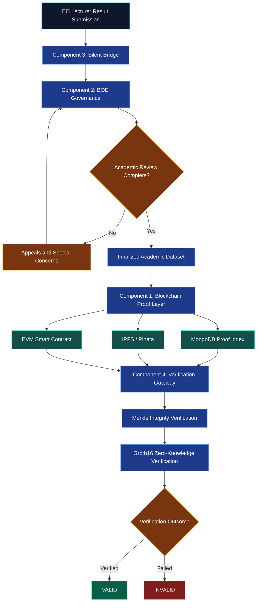
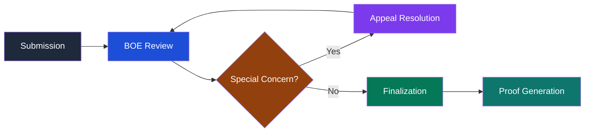
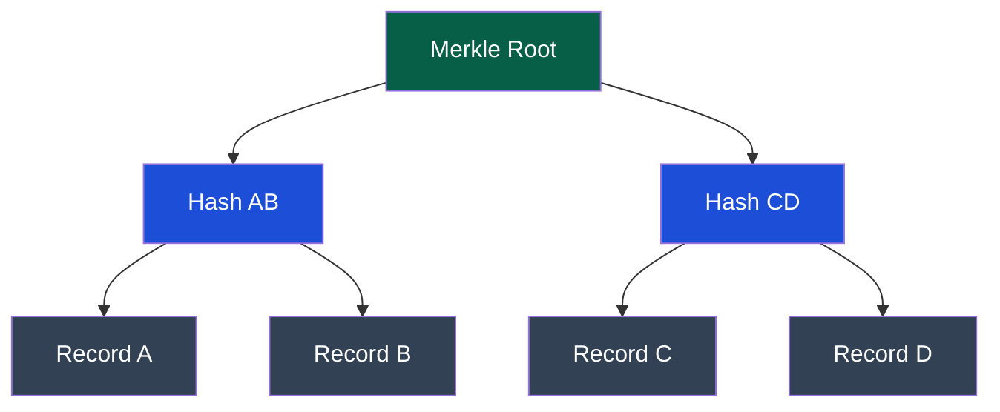
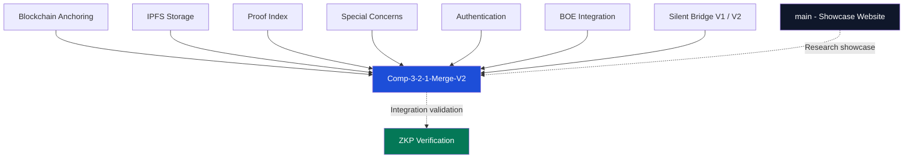
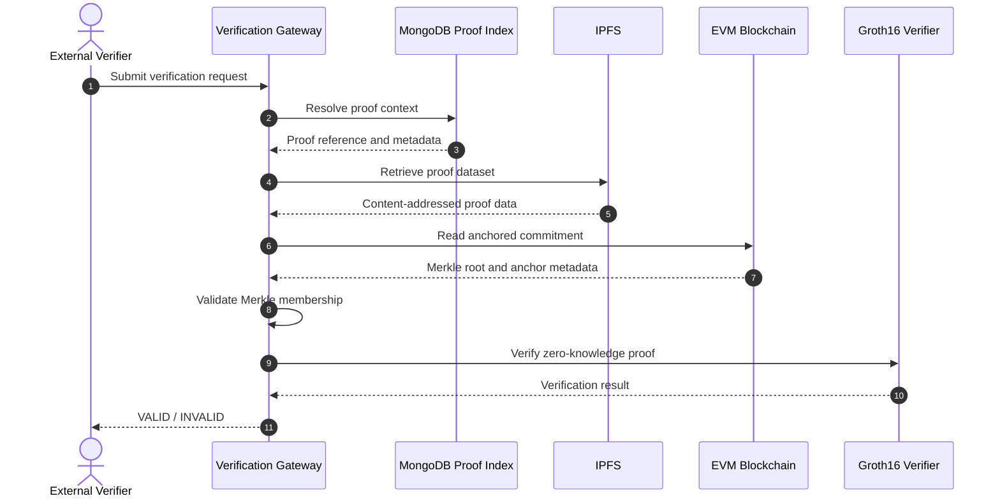

<div align="center">

# 🔐 BSAV
### Blockchain-Based Transparent and Secure Academic Grading Using Decentralized Verification

**A decentralized academic grading, governance, and privacy-preserving verification framework**

<br/>

[](https://bsav-blockchain-based-secure-academic-verification-fygavqks7.vercel.app/)
[](https://icdmis.ikrf.in/)
[](https://www.sliit.lk/)

<br/>


<br/>

**Academic Integrity • Decentralized Trust • Cryptographic Verification • Student Privacy**

[🚀 Explore Live Website](https://bsav-blockchain-based-secure-academic-verification-fygavqks7.vercel.app/) ·
[📚 Research Conference](https://icdmis.ikrf.in/) ·
[🎓 SLIIT](https://www.sliit.lk/)

</div>

---

## 📑 Table of Contents

- [Overview](#-overview)
- [Research Motivation](#-research-motivation)
- [Core Objectives](#-core-objectives)
- [System Architecture](#-system-architecture)
- [Component Breakdown](#-component-breakdown)
- [Storage and Governance](#-storage-and-governance)
- [Cryptographic Verification](#-cryptographic-verification)
- [Technology Stack](#-technology-stack)
- [Repository Branch Structure](#-repository-branch-structure)
- [Getting Started](#-getting-started)
- [Environment Configuration](#-environment-configuration)
- [Verification Workflow](#-verification-workflow)
- [Research Contributions](#-research-contributions)
- [Research Team](#-research-team)
- [Academic Publication](#-academic-publication)
- [License and Attribution](#-license-and-attribution)

---

## 🌍 Overview

> **BSAV establishes a verifiable trust layer for academic grading without requiring third parties to access sensitive student records.**

Traditional higher-education result management systems depend on centralized databases, institution-controlled records, and manual credential verification processes.

These approaches can introduce risks such as:

- Unauthorized academic record modification
- Privileged insider manipulation
- Limited transparency in grade moderation
- Inefficient verification of academic credentials
- Weak interoperability between institutions
- Unnecessary disclosure of sensitive student information

**BSAV (Research Project R26-SE-011)** proposes an integrated decentralized architecture that combines academic governance, cryptographic integrity, decentralized storage, and privacy-preserving verification.

The framework is organized into four independent components:

1. **Blockchain Proof Layer** — immutable anchoring of finalized academic commitments.
2. **BOE Governance Layer** — moderated academic decision-making and controlled finalization.
3. **Silent Bridge** — secure ingestion, normalization, and private audit recording.
4. **Verification Gateway** — independent integrity validation and zero-knowledge verification.

The system separates academic decision-making from cryptographic persistence, ensuring that records pass through governance and finalization before being committed to decentralized infrastructure.

### 🏆 Research Recognition

The research paper titled:

**"Blockchain-Based Transparent and Secure Academic Grading Using Decentralized Verification"**

has been accepted for presentation and publication at the **International Conference on Data Mining and Information Security (ICDMIS 2026)**.

| Research Information | Details |
|---|---|
| Research ID | R26-SE-011 |
| Institution | Sri Lanka Institute of Information Technology |
| Research Domain | Blockchain, Academic Security, Cryptography |
| Conference | ICDMIS 2026 |
| Paper Status | Accepted |
| Deployment | Vercel |
| Architecture | Four-Component Decentralized Framework |

---

## 🎯 Research Motivation

Academic grading systems require more than secure storage.

They must support:

- Fair academic review and moderation
- Traceable administrative decisions
- Integrity of finalized records
- Independent verification
- Student privacy
- Institutional accountability

Blockchain alone cannot determine whether an academic grade is correct.

Therefore, BSAV introduces a governance-first architecture where academic decisions are completed before cryptographic commitments are generated.

### The Core Principle

<div align="center">

**Academic Governance → Finalization → Immutable Anchoring → Independent Verification**

</div>

This approach ensures that cryptographic infrastructure preserves finalized academic decisions rather than replacing institutional governance.

---

## 🎯 Core Objectives

| Objective | Description |
|---|---|
| 🔒 Integrity | Detect unauthorized changes to finalized academic results |
| 🏛️ Governance | Enforce moderated approval and controlled academic finalization |
| 🌐 Decentralization | Distribute proof datasets using content-addressed storage |
| 🧾 Auditability | Maintain traceable academic processing and review records |
| 🛡️ Privacy | Verify academic claims without unnecessarily exposing grades |
| ⚡ Efficiency | Reduce manual third-party credential verification |
| 🔍 Transparency | Provide deterministic integrity-verification outcomes |

---

## 🏗️ System Architecture

BSAV uses a four-component architecture with distinct responsibilities and controlled data handoffs.

### High-Level Architecture



### Architectural Execution Order

Although the components retain their research numbering, the operational workflow follows:

```text
Component 3
    ↓
Component 2
    ↓
Component 1
    ↓
Component 4
```

**Ingestion → Governance → Anchoring → Verification**

---

## 🧩 Component Breakdown

### 🔹 Component 01 — Blockchain Proof Layer

**Decentralized Anchoring and Cryptographic Persistence**

This component transforms finalized academic records into independently verifiable cryptographic commitments.

#### Responsibilities

- Construct binary Merkle trees from finalized records
- Generate Merkle roots and membership proofs
- Publish finalized proof datasets to IPFS
- Store IPFS content identifiers
- Anchor Merkle roots through Solidity smart contracts
- Maintain Candidate ID and Module Code proof-index mappings
- Support subsequent verification of finalized records

#### Technology

`Solidity` · `Hardhat` · `Ethereum/EVM` · `IPFS` · `Pinata` · `MongoDB` · `Merkle Trees`

<details>
<summary><b>📂 Component 01 — Repository Branches</b></summary>

<br/>

| Branch | Responsibility |
|---|---|
| `feature/component-01-blockchain-anchoring` | Smart contract deployment and Merkle-root anchoring |
| `feature/component-01-ipfs` | IPFS proof dataset pinning and CID management |
| `feature/component-01-index-storage` | Candidate and module proof-index mapping |

</details>

---

### 🔹 Component 02 — BOE Governance Layer

**Academic Moderation, Appeals, and Finalization**

The Board of Examiners governance component controls the academic decision lifecycle before blockchain anchoring.

#### Responsibilities

- Role-based authentication and authorization
- Examiner moderation workflows
- Academic result review
- Version tracking
- Special concern and appeal handling
- Administrative audit logging
- Controlled finalization
- Secure handoff to the proof-generation layer

#### Governance Lifecycle



**Important:** The designed governance process requires all amendments to be resolved before anchoring. Any post-finalization correction would require a separately defined supersession or reissuance mechanism rather than modifying the original blockchain commitment.

<details>
<summary><b>📂 Component 02 — Repository Branches</b></summary>

<br/>

| Branch | Responsibility |
|---|---|
| `feature/component-02-special-concern` | Appeals and special concern processing |
| `feature/component-02-integration` | Finalized dataset handoff |
| `feature/component-02-authentication` | Authentication, authorization, and audit control |

</details>

---

### 🔹 Component 03 — Silent Bridge

**Secure Academic Data Ingestion and Private Audit Ledger**

The Silent Bridge connects existing academic result workflows with the decentralized BSAV architecture.

It is designed to minimize disruption to existing institutional systems.

#### Responsibilities

- Parse spreadsheet-based academic result submissions
- Support flexible spreadsheet schemas
- Normalize incoming grade records
- Remove unnecessary personally identifiable information
- Generate SHA-256 integrity commitments
- Maintain a chained private audit ledger
- Store ingestion metadata in MongoDB Atlas
- Route records into academic governance workflows

#### Processing Pipeline

```text
Academic Spreadsheet
        │
        ▼
Schema-Agnostic Parser
        │
        ▼
Record Normalization
        │
        ▼
PII Minimization
        │
        ▼
SHA-256 Chained Ledger
        │
        ▼
MongoDB Atlas
        │
        ▼
BOE Governance
```

#### Technology

`Node.js` · `Express` · `SheetJS` · `MongoDB Atlas` · `SHA-256`

<details>
<summary><b>📂 Component 03 — Repository Branches</b></summary>

<br/>

| Branch | Responsibility |
|---|---|
| `component-03-silent-bridge` | Initial ingestion and normalization engine |
| `component-03-silent-bridge-V2` | Context-aware routing and appeal handling |

</details>

---

### 🔹 Component 04 — Verification Gateway

**Privacy-Preserving External Academic Verification**

The Verification Gateway allows authorized verification workflows to evaluate cryptographic claims against finalized academic commitments.

Potential verifiers include:

- Employers
- Higher-education institutions
- Credential evaluation organizations
- Academic administrators
- Authorized external verification services

#### Responsibilities

- Resolve proof context using candidate and module references
- Retrieve corresponding cryptographic commitments
- Validate Merkle membership proofs
- Compare commitments against blockchain anchors
- Execute Groth16 zero-knowledge verification
- Return deterministic verification outcomes

#### Verification Endpoint

```http
GET /proof/record/...
```

The precise request parameters depend on the backend implementation.

#### Expected Outcome

```json
{
  "verification": "VALID",
  "integrity": "VERIFIED",
  "proofType": "MERKLE_AND_ZKP"
}
```

> The JSON above is an illustrative response structure, not a confirmed production API contract.

<details>
<summary><b>📂 Component 04 — Repository Branch</b></summary>

<br/>

`component4-zkp-formal-verification`

Groth16 proof circuits, verification integration, and formal verification research.

</details>

---

## 🗄️ Storage and Governance

BSAV deliberately separates operational storage, decentralized proof distribution, and immutable blockchain anchoring.

| Storage Layer | Purpose | Data Characteristics |
|---|---|---|
| MongoDB Atlas | Private ingestion ledger and proof index | Queryable and access-controlled |
| IPFS / Pinata | Finalized proof dataset distribution | Content-addressed |
| EVM Blockchain | Cryptographic commitment anchoring | Append-only blockchain records |
| Governance Layer | Academic review and finalization | Moderated institutional workflow |

### Separation of Responsibilities

**MongoDB Atlas**

Maintains the operational ledger and maps candidate/module references to their cryptographic proof contexts.

**IPFS**

Provides content-addressed storage for finalized proof datasets. The CID identifies the stored content.

**Ethereum / EVM**

Records the cryptographic anchor associated with finalized academic datasets.

**BOE Governance**

Controls the academic approval lifecycle before anchoring occurs.

> Blockchain immutability protects the historical commitment. It does not independently guarantee that an academic decision was correct when submitted.

---

## 🔐 Cryptographic Verification

BSAV combines several cryptographic mechanisms to support different security requirements.

### 1. SHA-256 Chained Ledger

The ingestion layer uses SHA-256 to construct tamper-evident chained audit records.

A conceptual chain structure is:

```text
H0 = SHA256(GenesisRecord)

H1 = SHA256(H0 || Record1)

H2 = SHA256(H1 || Record2)

H3 = SHA256(H2 || Record3)
```

Here, `||` represents an unambiguous, consistently encoded concatenation.

Changing an earlier record changes the expected hashes of subsequent records.

### 2. Binary Merkle Trees

Finalized academic records are represented through cryptographic leaf commitments.



Merkle proofs allow individual record commitments to be checked against an anchored root without retrieving every record in the dataset.

### 3. Groth16 Zero-Knowledge Proofs

Groth16 provides a mechanism for proving statements about private witness data without revealing the witness itself.

A conceptual academic claim could be:

> "This candidate satisfies a defined academic eligibility condition."

The verifier checks the proof against the appropriate public inputs and verification key without needing access to the underlying private marks.

The privacy guarantee depends on correct circuit design, public-input selection, witness handling, and trusted setup management.

### 4. Formal Verification

Certora is included in the research technology stack for formal verification activities.

Formal verification can be used to evaluate whether selected smart contract properties hold under a defined specification and model.

It does not automatically prove the correctness of the complete academic system.

---

## 🛠️ Technology Stack

<div align="center">

### Frontend


### Backend and Database


### Blockchain and Decentralized Infrastructure


### Hosting and Deployment


</div>

### Detailed Technology Matrix

| Domain | Technologies |
|---|---|
| Frontend | React 18, Vite 6, Tailwind CSS |
| Motion and Animation | Framer Motion |
| UI Components | Lucide React, Custom SVG |
| Backend | Node.js, Express |
| Database | MongoDB Atlas |
| Spreadsheet Processing | SheetJS (`xlsx`) |
| Cryptographic Hashing | SHA-256 |
| Proof Structures | Binary Merkle Trees |
| Zero-Knowledge Proofs | Groth16 |
| Smart Contracts | Solidity |
| Blockchain Development | Hardhat, EVM |
| Formal Verification | Certora |
| Decentralized Storage | IPFS, Pinata |
| Contact Integration | Web3Forms |
| Deployment | Vercel |

---

## 🌿 Repository Branch Structure

The repository separates individual research components from integration and showcase development.

| Branch | Function |
|---|---|
| `feature/component-01-blockchain-anchoring` | Solidity contract and Merkle anchoring |
| `feature/component-01-ipfs` | Decentralized proof storage |
| `feature/component-01-index-storage` | MongoDB proof indexing |
| `feature/component-02-special-concern` | Academic appeals |
| `feature/component-02-integration` | Governance-to-blockchain integration |
| `feature/component-02-authentication` | Access control and moderation |
| `component-03-silent-bridge` | Academic result ingestion |
| `component-03-silent-bridge-V2` | Advanced contextual routing |
| `component4-zkp-formal-verification` | Zero-knowledge verification |
| `Comp-3-2-1-Merge-V2` | Multi-component integration |
| `main` | Academic showcase website |

### Branching Strategy



This diagram describes the logical relationship between development areas rather than confirmed Git merge history.

---

## 🚀 Getting Started

### Prerequisites

Ensure that the following tools are installed:

- Node.js 18.x or 20.x
- npm, yarn, or pnpm
- Git
- A modern web browser

### 1. Clone the Repository

```bash
git clone https://github.com/NIKKAvRULZ/BSAV.-Blockchain-based-Secure-Academic-Verification.git
```

Navigate into the cloned repository:

```bash
cd BSAV.-Blockchain-based-Secure-Academic-Verification
```

### 2. Navigate to the Frontend

If the frontend application is located inside the `bsav` directory:

```bash
cd bsav
```

Otherwise, use the directory containing the frontend `package.json`.

### 3. Install Dependencies

```bash
npm install
```

### 4. Configure Environment Variables

Create a `.env` file in the frontend project directory.

```env
VITE_WEB3FORMS_ACCESS_KEY=your_web3forms_access_key_here
```

> **Security note:** Variables prefixed with `VITE_` are exposed to the browser build. Do not place blockchain private keys, database credentials, or other server-side secrets in these variables.

### 5. Start Development Server

```bash
npm run dev
```

Open:

**http://localhost:5173**

### 6. Build for Production

```bash
npm run build
```

### 7. Preview the Production Build

```bash
npm run preview
```

The commands above run the Vite-based showcase frontend. The research backend, smart contracts, and ZKP components may require additional setup in their respective branches.

---

## ⚙️ Environment Configuration

| Variable | Purpose | Exposure |
|---|---|---|
| `VITE_WEB3FORMS_ACCESS_KEY` | Website contact form integration | Browser-visible |

For backend and blockchain research components, configuration requirements depend on the relevant branch.

Potential configuration categories include:

- MongoDB connection settings
- IPFS / Pinata credentials
- Blockchain RPC endpoints
- Smart contract deployment configuration
- Cryptographic circuit artifacts
- Verification keys

Do not commit real credentials or secret keys to Git.

Recommended `.gitignore` entries:

```gitignore
node_modules/
dist/
.env
.env.local
.env.*.local
*.log
```

---

## 🔍 Verification Workflow

BSAV is designed to verify cryptographic claims against finalized academic commitments.

### Verification Sequence



### Verification Requirements

A successful verification requires the relevant cryptographic checks to pass, including:

1. Correct proof-context resolution
2. Integrity of the retrieved proof dataset
3. Valid Merkle membership
4. Matching anchored blockchain commitment
5. Valid Groth16 proof against the intended statement and public inputs

The gateway must reject invalid or inconsistent cryptographic evidence.

---

## 💡 Research Contributions

BSAV explores the combination of academic governance and decentralized verification through four main research contributions.

### 01 — Governance-First Blockchain Anchoring

Academic moderation and finalization occur before irreversible cryptographic anchoring.

### 02 — Non-Disruptive Academic Data Ingestion

A schema-flexible ingestion layer connects spreadsheet-driven academic workflows with decentralized infrastructure.

### 03 — Decentralized Academic Integrity

Merkle trees, content-addressed storage, and blockchain commitments provide mechanisms for independently checking record integrity.

### 04 — Privacy-Preserving Academic Verification

Groth16 proofs support verification of defined academic claims while reducing the need to disclose sensitive underlying records.

---

## 🎨 Interactive Academic Showcase

The deployed website presents the BSAV research through a modern React-based interface.

### Frontend Experience

- Responsive page layouts
- Framer Motion transitions
- Scroll-linked animation
- Parallax-inspired visual effects
- Spring-based motion
- Custom SVG visual elements
- Research component presentation
- Technology overview
- Contact integration

<div align="center">

### 🌐 Experience the Project

[](https://bsav-blockchain-based-secure-academic-verification-fygavqks7.vercel.app/)

</div>

---

## 👥 Research Team

### 🎓 Faculty Supervision

| Name | Role | Institution |
|---|---|---|
| Dr. Junius Anjana Vidanaralage | Supervisor | SLIIT Faculty of Computing |
| Ms. Thisara Shyamalee | Co-Supervisor | SLIIT Faculty of Computing |

### 👨‍💻 Student Researchers

| Researcher | Position | Research Responsibility |
|---|---|---|
| **M.A.I.D. Perera** | Group Leader | Component 01 — Blockchain Proof Layer |
| **H.P.C.D.P. Patabandige** | Member | Component 02 — BOE Governance |
| **W.A.N.I. Perera** | Member | Component 03 — Silent Bridge |
| **N.S.G. Perera** | Member | Component 04 — Verification Gateway |

**Academic Program:** Software Engineering

**Institution:** Sri Lanka Institute of Information Technology (SLIIT)

**Research Project ID:** R26-SE-011

---

## 📜 Academic Publication

### Accepted Research Paper

**Title:** Blockchain-Based Transparent and Secure Academic Grading Using Decentralized Verification

**Conference:** International Conference on Data Mining and Information Security (ICDMIS 2026)

**Year:** 2026

**Status:** Accepted for presentation and publication

**Conference Website:** https://icdmis.ikrf.in/

### BibTeX Citation

```bibtex
@inproceedings{perera2026bsav,
  author = {
    Perera, M. A. I. D. and
    Patabandige, H. P. C. D. P. and
    Perera, W. A. N. I. and
    Perera, N. S. G. and
    Vidanaralage, Junius Anjana and
    Shyamalee, Thisara
  },
  title = {
    Blockchain-Based Transparent and Secure
    Academic Grading Using Decentralized Verification
  },
  booktitle = {
    Proceedings of the International Conference
    on Data Mining and Information Security
    (ICDMIS 2026)
  },
  year = {2026},
  publisher = {IKRF},
  url = {https://icdmis.ikrf.in/}
}
```

> **Publication note:** This entry reflects the supplied acceptance information. Update the proceedings details, DOI, page numbers, and publisher metadata once the official publication record is available.

---

## 🛡️ Security and Privacy Considerations

BSAV is designed around several security principles.

**Data Minimization**

Only information required for cryptographic verification should be included in externally accessible proof material.

**Access Control**

Academic moderation operations should be restricted to authenticated and authorized institutional users.

**Integrity Verification**

Cryptographic commitments allow changes to finalized data to be detected when the appropriate verification checks are performed.

**Privacy-Preserving Proofs**

Zero-knowledge proof circuits should reveal only the public information required to validate a defined academic claim.

**Immutable Historical Commitments**

Previously anchored commitments remain part of blockchain history. Corrections require an explicit versioning or supersession strategy.

**Operational Security**

Smart contracts, backend services, verification circuits, and key-management processes require independent testing and security review.

---

## 📄 License and Attribution

This project was developed as an academic graduation research deliverable at the **Sri Lanka Institute of Information Technology (SLIIT)**.

**Research Project:** R26-SE-011

**Research Title:** Blockchain-Based Transparent and Secure Academic Grading Using Decentralized Verification

All rights reserved by the respective researchers and supervising faculty, subject to applicable institutional policies.

No open-source redistribution license is granted by this README.

---

## 🤝 Acknowledgements

The research team acknowledges the academic guidance and supervision provided by the faculty of the Sri Lanka Institute of Information Technology.

The project also recognizes the contributions of the open-source communities supporting blockchain development, decentralized storage, web engineering, and cryptographic verification research.

---

<div align="center">

### 🔐 BSAV — Securing Academic Trust Through Decentralized Verification

**Integrity by Design. Privacy by Proof. Trust Through Verification.**

<br/>

[](https://bsav-blockchain-based-secure-academic-verification-fygavqks7.vercel.app/)
[](https://icdmis.ikrf.in/)

<br/>

**Made with ❤️ for Academic Integrity and Decentralized Trust**

**© 2026 BSAV Research Team — SLIIT**

</div>
